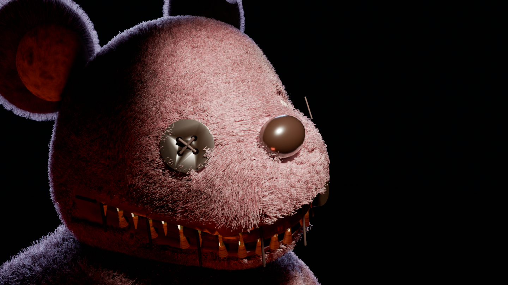
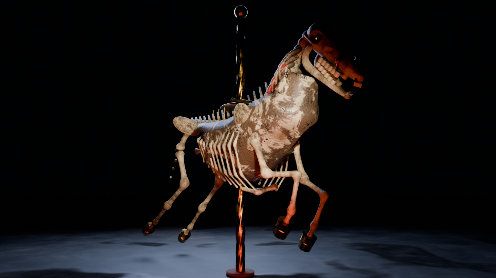
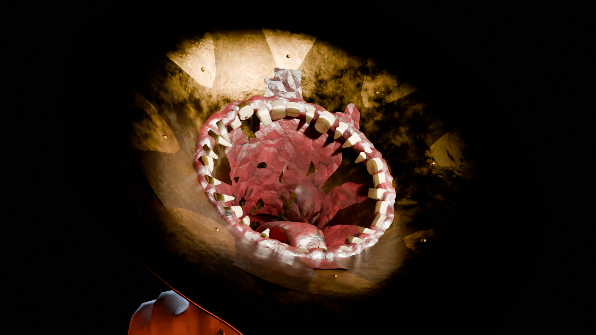
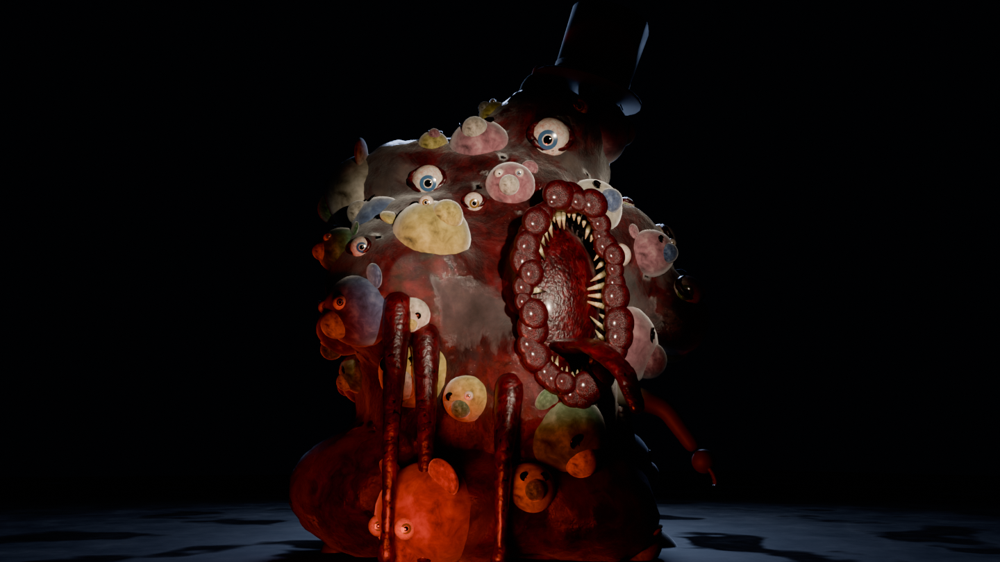

# 微笑樂園：最後一場表演

第一人稱恐怖遊戲（Three.js），所有生物與道具都用 Blender Python 腳本建模。

**▶ 線上遊玩：https://zianyu503-art.github.io/grinny-gardens/**（電腦或手機／平板皆可，建議戴耳機）

1996 年 8 月 31 日，微笑樂園在一夜之間關閉，二十七個孩子沒有回家。
你帶著「抓抓爪」回到廢棄樂園，穿過旋轉木馬廣場、鬼屋、員工通道、雲霄飛車和摩天輪，找出真相。

| 咪咪熊 Grinny | 骨馬 | 喇叭先生 | 園長 |
|---|---|---|---|
|  |  |  |  |

## 遊玩

```bash
npm install
npm run dev
```

打開 http://localhost:5173，建議戴耳機。

觸控版（手機／平板自動啟用，請橫放）：左半邊拖曳移動、推到底奔跑；右半邊拖曳轉頭；右下角按鈕發射左爪／右爪、互動、蹲下、手電筒；右上角地圖與暫停。電腦上可用 `?touch=1` 強制開啟觸控介面測試。

鍵盤操作：WASD 移動 · Shift 奔跑 · C 蹲下 · F 手電筒 · E 互動 · 滑鼠左／右鍵 發射左／右爪 · Esc 暫停

除錯捷徑：`?zone=carousel|funhouse|tunnel|coaster|ferris` 直接跳到該區。

## 重新產生模型（需要 Blender 5.x）

```bash
# 高品質生物 .blend、預覽渲染圖（renders/）
blender -b --factory-startup --python blender/make_creature.py -- grinny 96
# 遊戲用 GLB：減面、展 UV、烘焙貼圖、綁骨架與動畫
blender -b --factory-startup --python blender/game_export.py -- grinny hornman horse director
blender -b --factory-startup --python blender/game_export.py -- props
```

- `blender/lib.py`：建模工具與程序化材質
- `blender/creature_*.py`：四隻生物
- `blender/props.py`：樂園道具
- `blender/source/ClawPack.blend`：玩家的抓抓爪（手工建模），用 `blender -b --factory-startup --python blender/export_user_clawpack.py` 匯出成 `clawpack_full.glb`（入口撿到的背包）與 `clawhands.glb`（第一人稱的藍爪／紅爪，爪指可動）
- `src/`：遊戲程式（關卡 `level.js` + `park.js`、劇情與謎題 `game.js`、怪物 AI `monsters.js`）

### 樂園地圖

整座樂園來自 `blender/source/GRINNY_GARDENS.blend`。`blender/export_park.py` 把它切成六個區域（入口、廣場、鬼屋、員工通道、雲霄飛車、摩天輪），拉開區域之間的距離，再匯出成 `public/models/park.glb` 和 `public/park.json`（碰撞、燈光、重要位置）。

要調整間距或整體大小，改 `blender/layout.json`（`scale`、每區的 `gap`），然後重新匯出：

```bash
blender -b --factory-startup --python blender/export_park.py
```
